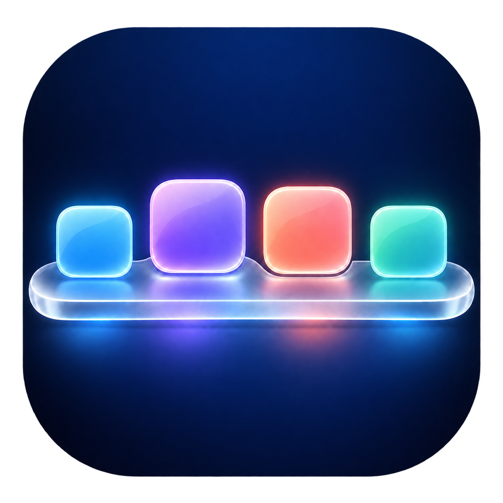

# alpha92 — native drag/drop bridge and circular icon sizing

Circular mode no longer falls back to normal while editing or dragging. Proxy buttons have UIKit drag interactions that obtain the original native icon interaction and forward native drag items and lifecycle events to its original delegate. The Dock carousel has a drop interaction forwarding local sessions to the native Dock list drop delegate. Session contexts keep delegate/interaction identity stable until end, even if the live source map changes. Missing native support rejects a drag or drop safely. No custom application identifier payload or manual icon model rewrite is introduced. An empty carousel remains visible to accept a drop.

Circular Icon Size is independently adjustable from 0.6x to 1.3x in Settings; it applies live and keeps icons inside the Dock capsule. Normal mode and rotation speed behavior are retained.

532 isolated mock native delegate and size checks passed, including drag cancellation, native item identity, local-drop restriction, original interaction forwarding, context cleanup, empty Dock persistence and size containment. 1220 carousel regression checks and 200 preference bundle/view checks also passed on iOS16.7.16. No real apps were moved/launched and no window was shown. These are not live SpringBoard drag/drop results; a real Home Screen gesture test after installation is still needed. Runtime support on other release families remains experimental under the existing opt-in gates. No automatic installation or respring was performed.

# alpha91 — adjustable carousel speed

Circular mode now defaults to twice the previous angular movement per finger swipe. Rotation Speed in Settings adjusts it between 0.5x and 4x relative to alpha90. Changes apply live; normal mode is unaffected. 1220 isolated carousel regression checks and 195 preference bundle checks passed on iOS16.7.16. No installation or live Home Screen gesture test was performed.

# alpha90 — in-Dock horizontal carousel correction

The circular mode now stays inside a 64–88 point tall Dock capsule. It uses a shallow horizontal orbit with depth scaling, rather than the previous full-height ring. Horizontal finger movement rotates the apps cyclically, release snaps to a position, and tapping an icon opens its native Dock app. Hit-test order follows visual depth. Editing temporarily restores the normal Dock; normal remains the default. Portrait and landscape bounds are covered by isolated tests.

1220 isolated geometry, tap wiring, rotation/cancel, alpha restoration, containment and orientation checks passed on iOS16.7.16, along with 190 preference bundle/view checks. These tests use synthetic apps and hidden views; they do not establish live SpringBoard gesture behavior. No installation, respring or actual app launch was performed. Other release families remain experimental under the existing compatibility gates.

# MaxDock

## alpha88 — experimental release-family preview (rootless)

This is not verified full runtime support for every iOS release or device. Package dependencies now accept firmware>=15 and<27; both production binaries target iOS15.0 and contain signed arm64 and arm64e slices. The supported preview families are15,16,17,18,26. Real runtime validation in this work remains iOS16.7.16. The previously observed iOS26 freeze has not been diagnosed to a specific Dock call by a matching stack trace, and this preview does not establish that the freeze is fixed there.

On15/17/18/26 the constructor returns before ALL hooks, migrations, observers and timers unless Enabled is true AND a new per-OS RuntimeOptInMajor matches the current major. Existing saved Enabled values alone cannot activate an unverified family. On those OSes the user must enable from Settings, then use Apply and Respring. There is no default activation on initial installation. iOS16 retains existing activation behavior. The preferences page now displays Compatibility Status and explains the preview. Disabled-runtime paths also gate Dock gestures, background replacement and auto-hide, and restore the vertical position without reading private editing state.

The preview retains signature-checked feature groups; incompatible groups skip, which may leave individual features unavailable. Public deployment-target compatibility and installation acceptance are not proof of private SpringBoard behavior. Only use with a suitable rootless jailbreak and ElleKit. Rootful installations are not supplied. No automatic installation, respring or feature activation was performed by the agent.

44 runtime-policy tests passed for default-disabled states, rejection of stale per-OS opt-in, explicit opt-in, baseline16 behavior and unsupported families. Another53 color/signature checks and183 actual preference-bundle/view-load checks passed in isolated processes on16.7.16. Test processes did not read/write real preferences or show a window. Prior position/capacity tests are historical; their unchanged engine components were not separately re-run for every unverified OS.


## alpha87 — reach the bottom edge

Removed the previously imposed24-point bottom band at the user's request. The maximum positive offset now places the resting Dock content's bottom exactly on the logical viewport bottom, without extending it below the screen. Zero keeps the native position; negative offsets and the stable unscaled viewport calculation are unchanged. No preference or runtime OS-support change.

573 isolated UIKit checks passed, including an explicit bottom-edge equality check, repeated layout writes, app-transition zoom and drag/hit testing. Both binary architectures are packaged. No automatic installation or real Dock position change was performed.

Install and restart SpringBoard once. Set Settings > MaxDock > Dock Position > Vertical Offset to its maximum to reach the edge. Live appearance after installation remains to be confirmed.


## alpha86 — stable maximum offset across app transitions

Read-only geometry observation on the connected iOS16.7.16 device found that SBIconContentView is hidden and scaled to .88 behind Settings. Alpha85 measured the limit through that ancestor transform: a requested120 could produce an applied57.28 in the hidden layout, even though the untransformed native viewport only had13 points of remaining room. Returning Home changed the ancestor scale and reduced the limit again, causing the reported down/up correction.

The clamp now uses the nearest full-screen ancestor's logical bounds, excluding its and higher ancestors' transition transforms. If no matching full-screen ancestor exists, it falls back to window coordinates. The early capacity provider, native setter mediation, no-animation corrections, hit testing and drag save/cancel are retained. No preference schema or UI change.

A regression test reproduces the old failure with alpha85 in an isolated UIKit process. The corrected implementation passes572 checks, including60 cycles through .88/.94/1 scaling and hidden/visible Home Screen states at maximum offset, plus all prior position tests. No window was shown and no real Dock or preferences were modified. The build contains signed arm64 and arm64e. Live behavior after installing alpha86 remains to be verified. Restart SpringBoard once after installation.


## alpha85 — remove periodic position correction hop

The vertical offset adapter now mediates native SBDockView center/frame writes before UIView receives the requested target, rather than letting native layout expose the unshifted target until the next layout/poll correction. The same mediation is present for the legacy Dock-list fallback. Setter ABI signatures are checked before installing the group. Internal/nested writes are guarded so an offset is not applied twice. Genuine native layout animations retain their animation context; only the adapter's own center/handle corrections disable UIView animations and implicit Core Animation actions.

389 isolated UIKit position tests passed, including repeated native center/frame resets, immediate offset target delivery, unchanged repeat updates, disabled animation context during own corrections inside an animated caller, preserved animation context for genuine native changes, moved hit testing, drag save/cancel and landscape restoration. No window was shown and the real Dock was not modified. The recurring hop has not been verified live on the affected device; the change targets the source-level reset/repair and inherited-animation paths.

Preference source and Root.plist are identical to alpha84 (179 preference checks recorded there); only the bundle version changed. Both production binaries contain signed arm64 and arm64e slices. Install then restart SpringBoard once so the newly added setter hooks load.


## alpha84 — vertical Dock position and edit-mode handle

Added Dock Position controls: vertical offset (-100 to +120 points, positive lowers the Dock) and an edit-mode drag handle. The requested offset is applied to the Dock host center, preserving its native baseline, rather than moving individual icons. Background and child hit testing therefore follow the same host coordinate system. Repeated updates detect the last applied center to avoid accumulating translation. Auto-hide transforms are left unchanged. Zero restores the native center.

A small blue drag handle appears while editing icons. Drag vertically and release to save the effective clamped offset in the existing preference domain; cancelled drags restore the initial requested value without saving. The handle is hidden outside edit mode, when disabled, and when the window bounds are landscape. Home-screen active recognition is polled through the existing two-second compatibility timer plus Dock layout updates. The control does not install another private method hook.

The position limit uses resting material bounds when visible, falling back to icon-image bounds, and retains a 24-point bottom band. Existing native offsets are not forcibly corrected when the configured offset is zero. Only portrait placement is implemented; landscape temporarily restores the native center. Geometry, nesting and gestures in a real SpringBoard installation still need user verification.

134 isolated native UIKit position tests passed, including 100 repeated updates, offset bounds, moved-button hit testing, native parent-center resets, unchanged auto-hide transforms, mock drag save/cancel callbacks, restoring zero, and landscape behavior. No window was shown or real Dock/preferences modified. Another 179 checks loaded the actual staged preferences bundle, its 38 rows, selector bindings and view using synthetic default values. Both binaries were built and signed for arm64 and arm64e. The package was not installed automatically.

Usage: Settings > MaxDock > Dock Position > Vertical Offset. Positive values move down. Alternatively, enter Home Screen icon editing and drag the blue handle.


## alpha83 — early independent Dock capacity

Split SBHDefaultIconListLayoutProvider into a dedicated, signature-checked hook group, installed synchronously before the deferred UI hook initialization. The previous combined group could be skipped when an optional visual method differed, or be installed after the initial model configuration was cached. Both paths could retain the native four-icon ceiling. The capacity hook now operates independently of the visual group and checks all grid setter signatures before updating columns/rows. No random Dock fill or icon insertion was reintroduced. All UI initialization remains deferred to the main queue.

32 isolated capacity tests passed for 5/8/12/20/100 columns and rejection of unsupported setter types. Native setter signatures were inspected on iOS16.7.16 without modifying its Dock. The actual new bundle also passed 166 preference-load checks. Package retains signed arm64 and arm64e slices. Actual drag-in admission beyond four icons on the affected device has not been tested; no installation was performed.

After installation enable Allow Extra Dock Apps, choose Dock Capacity (e.g.12), then use Apply and Respring. Add icons manually afterward. Restarting SpringBoard is required to rebuild an already cached admission ceiling. The package remains limited to iOS16.x.


## alpha82 — preference loader repair

Replaced the manually declared SpecifiersFromPlist C function with PSListController loadSpecifiersFromPlistName:target:. Root.plist is now the complete 35-row title/items definition, including the original getters, setters and actions. Removed undefined,dynamic_lookup linker relaxation. Both arm64 and arm64e are retained.

166 isolated native checks loaded the actual staged preference bundle, created all specifiers and the view, and validated control selectors. Preferences were supplied as defaults in the test; no real values were read or written and no buttons invoked. Test runtime: iOS16.7.16. The Settings crash from the affected device remains necessary to confirm its exact cause if closing persists. The full DEB remains limited to iOS16. The separate preferences-only ZIP does not change the runtime engine or add compatibility with iOS17/18/26.


## iOS16 rootless alpha81 — fresh-install startup hardening

Removed the complete first-install random Dock fill routine and its 6/12/20-second retries. Previously it inserted application icons into the persistent Dock model and saved the icon state on fresh devices, whereas a previously seeded device skipped that path. This is a plausible explanation for a fresh-device-only hang, not a root cause established by a matching crash report. Users can add Dock apps manually.

All nine hook groups now validate complete return/argument signatures before installation. Incompatible groups log and skip. Initialization is scheduled on the main queue. Both arm64 and arm64e slices are retained for the tweak and preference bundle.

53 synthetic UIKit checks passed, covering type mismatch rejection and existing color/OS checks. Live signature metadata for critical Dock/list methods matches the iOS16.7.16 implementation, but no new hooks were installed during that check. Fresh installation on the reported iPhone14/iOS16 device remains unverified. iOS18 is still unsupported and package/runtime OS bounds remain iOS16.x. A matching hang/crash log from an affected device is needed to establish any remaining cause.


## iOS16 rootless alpha80 — arm64e preference loading

Both Harbor.dylib and the harborprefs preference executable now ship as signed universal arm64 + arm64e Mach-O binaries, with deployment target iOS16.0. This fixes the missing arm64e slice reported by dlopen_preflight on iOS16.1.2. The earlier arm64-only release was built for iPhone X and must not be treated as a universal package. Package contents were verified; no installation or live iOS16.1.2 preference-load test was performed. The package remains limited to iOS16.x.


## iOS 16 rootless alpha 79 — compatibility boundary

The package now requires firmware >=16 and <17. The constructor independently rejects every OS major other than 16 before preference migrations, timers, observers, hooks, or Dock model writes. This prevents accidental activation of iOS 16 private Dock adapters on iOS 26. It does not add support for iOS 26 or establish the exact cause of the reported black screen. The forceReset report records btn_rst; the user confirmed a forced reboot after installing on iOS 26 and recovery after removing MaxDock. Do not override package dependencies.


## iOS 16 rootless alpha 78

The selection outline and glow now follow the dominant saturated color of the selected app artwork. White/transparent backgrounds are ignored; neutral artwork uses a readable gray fallback. Colors are sampled from a 24×24 bitmap and cached by image, outside the per-frame magnification path. Missing artwork is retried until available. Existing selection pulse, geometry, and feedback are retained.

40 native UIKit checks passed using synthetic artwork. Live Dock appearance has not been verified and the package was not installed automatically.




Developed by **Flip Max**.

## iOS 16 rootless alpha 74

Alpha 74 rolls back the incompatible sparse native-column experiment from
alphas 72-73 and restores MaxDock's proven explicit icon-center distributor.
Only that small positioning pass runs after an iOS Dock-list layout; icon
scaling, background construction, and material discovery remain signature-
gated. This separates every sparse Dock icon while retaining alpha 70's paging
and performance protections.

## iOS 16 rootless alpha 73

Alpha 73 fixes sparse Dock stacking on iOS 16.7.16 by resolving the live count
from both SpringBoard's private model and the concrete visible SBIconViews. A
transient zero model count can no longer be converted into a one-column inset.
When no trustworthy count is available, MaxDock leaves the native layout
untouched until SpringBoard finishes creating its icon views.

## iOS 16 rootless alpha 72

Alpha 72 removes direct per-icon center mutation, which could fight the iOS 16
list layout and stack sparse Dock icons on top of one another. The visual layout
now exposes exactly one native column per real icon and receives symmetric,
count-aware insets calculated from the same icon extent and gap used by the
compact background. Sparse and crowded Docks therefore share one native,
centered geometry without a per-frame positioning pass.

## iOS 16 rootless alpha 71

Alpha 71 is the compile hotfix for alpha 70. It removes the obsolete static
visual-envelope helper left behind by the performance rewrite, eliminating the
`-Werror,-Wunused-function` build failure without changing alpha 70's centered
Dock geometry or page-scrolling optimizations.

## iOS 16 rootless alpha 70

Alpha 70 replaces alpha 69's live per-icon envelope and drag-layout polling
with one deterministic center shared by both the icon strip and its frosted
background. Full scaling and material updates now run only when the Dock count,
bounds, or preferences change. Repeated page layouts perform only a lightweight
row-centering pass, queued refreshes are coalesced, and the Dock pan recognizer
no longer cancels or blocks SpringBoard's page-scrolling pan.

## iOS 16 rootless alpha 69

Alpha 69 measures the real first and last icon artwork edges when sizing and
centering the compact frosted background. This keeps every icon enclosed after
any Dock count change instead of relying on temporarily stale SpringBoard slot
metrics. The currently grabbed edit-mode icon is also matched continuously to
the destination Dock size, preventing an oversized drag representation while
leaving all resting icon transforms stable.

## iOS 16 rootless alpha 68

Alpha 68 keeps MaxDock's one-row center distribution active while the Home
Screen is in edit mode, pausing it only for the short interval in which an icon
is actually grabbed. It also removes both associated and orphaned legacy green
running dots, including markers whose original icon view was recycled before
alpha 67 disabled the feature.

## iOS 16 rootless alpha 67

Alpha 67 retires temporary process-backed Dock icons and green running dots
from both the engine and Settings. Existing enabled preferences are disabled
once during migration. MaxDock continues selecting Arabic or English from the
device's preferred language, displays the developer as Flip Max, and ships
properly rounded transparent 2x/3x preference artwork.

## iOS 16 rootless alpha 66

Alpha 66 keeps the compact frost completely fixed while the macOS icon wave is
active. The last precisely centered resting frame is cached before tracking and
reused until the finger is released, so only the icons rise and magnify. This
release also introduces the MaxDock identity, developer metadata, and original
professional preference artwork while preserving the established package and
preference identifiers for seamless upgrades.

## iOS 16 rootless alpha 65

Alpha 65 teaches the compact frost about Harbor's active macOS gesture. While
the finger is moving across the Dock, the material follows the live magnified
icon envelope in both size and position so raised icons remain inside it. As
soon as tracking ends or is cancelled, the active flag clears and the frost
returns to alpha 64's thin, precisely centered resting geometry.

## iOS 16 rootless alpha 64

Alpha 64 positions the compact frost on the actual icon row. The horizontal
center follows the midpoint between the first and last valid icon, and the
vertical center follows the average valid icon center. Both corrections are
tightly bounded around the Dock center, preserving alpha 63's deterministic
compact size while giving the icons equal visual margins on every side.

## iOS 16 rootless alpha 63

Alpha 63 makes the independent frost geometry fully deterministic. Its resting
width is calculated from the current icon count, Harbor's target icon size, and
a small fixed gap, while its height follows one icon rather than any private
SpringBoard container. Valid per-icon visual sizes may add only the bounded
space needed during macOS magnification. Recycled iOS 16.7 icon hosts can no
longer expand the frost to the complete Dock rectangle.

## iOS 16 rootless alpha 62

Alpha 62 replaces the custom `UIVisualEffectView`, which the iPhone X A11 Dock
compositor grouped with Apple's hidden material, with a standalone translucent
frost gradient and independent ice border. Harbor raises this view above every
native Dock background and then raises the actual icon containers and running
indicators above Harbor, guaranteeing the intended material order. The shape
mask and managed compact geometry remain active, while the custom background
no longer depends on Apple's private blur hierarchy to render. A one-time
alpha 62 migration selects the adaptive frost and clears the global Hide
Background switch, while Apple's material remains independently suppressed.

## iOS 16 rootless alpha 61

Alpha 61 adds geometry-based suppression for any large direct Dock child that
contains no icon views, covering native material classes whose names differ on
iOS 16.7.16. Harbor's frost also receives an independent rounded shape mask in
Dock coordinates. Even if SpringBoard rewrites the visual-effect frame or its
private backing layer directly, only the compact calculated icon envelope can
remain visible. A defensive height ceiling prevents recycled off-row icon
geometry from recreating the full native platter.

## iOS 16 rootless alpha 60

Alpha 60 identifies and suppresses the native `SBDockView` wallpaper-effect,
background-image, accessibility, and material fallback views directly after
every Dock layout. On iOS 16.7.16 these backing views can remain visible even
when `setBackgroundAlpha:0` succeeds, making the native full-height platter
look like a stretched Harbor background. Original visibility, alpha, layer
opacity, and Dock color are retained for safe restoration when the replacement
is disabled. Harbor's locked compact frost is then the only visible material.

## iOS 16 rootless alpha 59

Alpha 59 locks the frosted material to Harbor's calculated icon envelope.
SpringBoard 16.7 can rewrite a direct visual-effect descendant to the native
full Dock bounds after layout, producing the large platter seen on iPhone X.
The managed frost now accepts frame, bounds, and center updates only from
Harbor while retaining the directly hosted effect required by the A11 Dock
mask. The compact alpha 57 icon distribution and foreground application
tracking remain unchanged.

## iOS 16 rootless alpha 58

Alpha 58 restores the directly hosted frosted visual-effect view that renders
reliably inside the iPhone X Dock mask on iOS 16.7.16. The neutral wrapper from
alpha 56/57 could be composited below that private mask and become completely
invisible. The compact centered icon distribution introduced in alpha 57 is
retained, so the visible frost follows the smaller content strip instead of
returning to the previous edge-to-edge geometry. A one-time preference
migration also enables the adaptive frost and clears a previously saved Hide
Dock Background value that could otherwise suppress the replacement entirely.

## iOS 16 rootless alpha 57

Alpha 57 replaces the unavailable post-iOS-13 `SBApplication.mainScene`
requirement with foreground-admission tracking. An application becomes a
temporary Dock item only after its process has genuinely occupied the
foreground, remains present while that process is alive, and is forgotten when
the process exits. This preserves newly opened applications on iOS 16.7 while
excluding prewarmed and background-only services. Dock icon centers now form a
compact, centered strip with a small proportional gap, allowing the frosted
background to fit the content instead of stretching close to both screen edges.

## iOS 16 rootless alpha 56

Alpha 56 keeps the frosted adaptive background compact by wrapping its blur in
a neutral Harbor-owned view that SpringBoard cannot reinterpret as the native
full-height Dock material. Invisible and recycled icon containers no longer
participate in the measured envelope, and implausible off-Dock frames are
discarded defensively. Temporary Dock applications now require both a running
process and a live main scene, preventing background services and prewarmed
applications from appearing as user-opened apps.

## iOS 16 rootless alpha 55

Alpha 55 fixes magnified icons extending beyond the adaptive background. The
background envelope now combines each icon's real Harbor content scale with its
live outer magnification transform, instead of relying only on UIKit's converted
frame. It is placed immediately above Apple's hidden Dock material and directly
below the icon containers so it remains visible. The dark Ultra Thin Dark glass
is replaced with a translucent Ultra Thin Light frost, a soft white tint, and a
brighter ice edge while preserving the compact ten-point horizontal margin.

## iOS 16 rootless alpha 54

Alpha 54 replaces the wide native phone Dock background with a compact,
ultra-thin glass pill around the visible icons. Its width follows the first and
last icon with only a ten-point margin, while its height follows the live icon
envelope during Harbor magnification and springs back afterward. The background
also resizes when temporary running apps appear or disappear, stays behind all
icons and indicators, and never participates in hit testing. A localized
Settings switch enables or disables the adaptive material; Hide Dock Background
still removes every background for the fully transparent profile.

## iOS 16 rootless alpha 53

Alpha 53 fixes black letter placeholders on temporary running applications.
iOS 16 uses SBIconImageView rather than UIImageView for Home Screen artwork;
this build reads iconImageSnapshot/displayedImage from existing native views,
supports the modern SBIconImageInfo generator, and embeds a cache-backed native
SBIconImageView when artwork arrives asynchronously. The text placeholder is
now only a final fallback when SpringBoard exposes no compatible image path.

## iOS 16 rootless alpha 52

Alpha 52 keeps the installed Dock applications fixed and adds each other
running application as a temporary Dock icon. Temporary icons use their real
application artwork, join Harbor's adaptive spacing and magnification, launch
when tapped, and disappear when their process is removed from the app switcher.
The implementation never moves temporary applications into the saved icon
model, so it cannot rearrange the Home Screen or permanently alter the Dock.
Running-state results are cached and invalidated only by application lifecycle
callbacks, with a low-frequency compatibility poll for iOS 16.7.x.
The Dock background is hidden by default when upgrading to this build, while
the existing 12 installed Dock applications remain fixed and user-editable.

## iOS 16 rootless alpha 51

Alpha 51 fills the Dock to 12 applications once after the first installation.
It waits for SpringBoard's iOS 16 icon manager and Dock model to finish loading,
keeps applications already in the Dock, randomly chooses visible application
icons without duplicates, inserts the missing applications in one native model
transaction, and saves the resulting icon state. It never repeats after a
successful fill, so later removals and the user's final ordering are preserved.

## Alpha 50

Alpha 50 replaces the retired smart-folder idea with a lightweight notification
attention animation. Dock applications with a visible notification badge make
two gentle repeating hops and stop automatically as soon as the badge clears.
The feature is enabled by default and has its own localized Settings switch.
It uses one Core Animation per badged icon and never creates folders, thumbnail
images, layout timers, or hidden icon groups.

## Alpha 49 emergency stability rollback

Alpha 49 removes the smart running-app folder, live thumbnail rendering, icon
folding, and recent-app tap tracking from SpringBoard. Those paths could run
inside repeated Dock layout passes and cause stalls on A11 devices. The stable
single-row Dock layout, adaptive icon sizing, macOS magnification, running dots,
auto-hide, launch bounce, profiles, and localization remain available. The
migration also clears the old recent-app state and permanently disables its
retired preference.

## Alpha 48

Alpha 48 redesigns the smart running folder as one normal Dock slot. Three or
more running applications collapse into a same-size folder icon with miniature
previews, while the remaining Dock icons are compacted without empty slots. The
folder participates in Harbor magnification. Tapping it temporarily expands the
running applications in the Dock for four seconds; closing them from the app
switcher removes the folder automatically when fewer than three remain.

## Alpha 47

Alpha 47 removes swipe-up shortcuts and their Settings switch. The running-app
divider is replaced by a smart folder that appears when at least three Dock
applications are running. It shows three miniature icons; tapping it reveals
the underlying applications for four seconds. The folder disappears when fewer
than three Dock applications remain running. Temporary diagnostic UI is removed.

## Alpha 46 diagnostic

Alpha 46 prevents an upward shortcut swipe from falling through to either app
launch or icon-edit/delete mode. Only the icon's native iOS context interaction
is allowed; unavailable menus report MENU X safely. The divider now represents
currently running Dock applications and disappears when none remain running.

## Alpha 45 diagnostic

Alpha 45 presents the icon's own `UIContextMenuInteraction` directly when an
upward swipe is recognized, before trying SpringBoard legacy fallbacks. Recent
history is reset once for this migration and its divider stays hidden until
three distinct Dock applications have actually been opened.

## Alpha 44 diagnostic

Alpha 44 uses `SBApplication.processState.isRunning` and the iOS 16
`_setInternalProcessState:` callback for live indicators. Swipe-up now tries the
icon manager's immediate context-menu reveal path first. The recent section has
a visible divider, so successful TAP tracking is reflected clearly in the Dock.

## Alpha 43 diagnostic

Alpha 43 targets iPhone X on iOS 16.7.x. It uses SBIconView's modern
`applicationBundleIdentifier` and `tapGestureDidChange:` paths and adds a small
temporary Dock diagnostic badge: H43 confirms injection, TAP confirms recent
tracking, SWIPE confirms the shortcut gesture, and RUN confirms application
activation callbacks. The badge is intentionally temporary and will be removed
after device validation.

## Alpha 42

Alpha 42 is a compatibility repair for devices where all three alpha 41
features remained inactive. It hooks SpringBoard's real activation-state and
delegate-touch callbacks, reads the application directly from SBApplicationIcon,
allows the vertical shortcut gesture to coexist with Harbor's Dock pan, and
falls back to SBIconView's own long-press timer before legacy controller APIs.

## Alpha 41

Alpha 41 fixes the three runtime paths behind the power features: running dots
now live in the Dock overlay and use modern application-state fallbacks, normal
Dock taps update the recent-app ordering, and swipe-up shortcuts first use the
SBIconView delegate path used by modern SpringBoard. A lightweight state poll
keeps indicators current when a firmware does not emit the legacy callback.

## Alpha 40

Alpha 40 adds running-app indicators, an optional three-item recent Dock
section, auto-hide with bottom-edge reveal, macOS-style launch bounce, runtime-
gated swipe-up shortcuts, and macOS/Compact/Transparent/Gaming profiles. Riskier
private-API features are disabled by default and can be tested independently.

## Alpha 39

Alpha 39 supports both `SBHRootFolderView` and legacy `SBRootFolderView` when
hiding the Home Screen search pill. It recognizes the control through runtime
class names, Arabic/English accessibility labels, or visible label text, then
hides the complete compact container rather than only its text child.

## Alpha 38

Alpha 38 sets Dock Capacity to 12 once on first launch of this layout version.
It adds live switches for hiding the Dock background and the Home Screen search
pill. The search control is identified by runtime class/accessibility metadata
and position, so Spotlight itself remains available through the swipe gesture.

## Alpha 37

Alpha 37 removes forced post-drop size invalidation when the Dock signature is
unchanged. Routine icon reparenting reuses the established scale, and pending
sublayer-transform animations are cancelled before the stable value is set.
Resting size now changes only for a real count, bounds, or preference change.

## Alpha 36

Alpha 36 separates position maintenance from size calculation. Icon centers
remain constrained on every layout pass, while resting size is recalculated
only when the icon count, Dock bounds, or size preferences change. Routine
SpringBoard image refreshes now reuse the cached scale, preventing idle
grow/shrink oscillation. A final post-drop measurement runs at 0.90 seconds.

## Alpha 35

Alpha 35 localizes the preferences interface automatically from the device
language, including a complete Arabic layout with right-to-left direction. It
also adds an optional animated cyan selection glow around the focused icon.
The glow, app-name bubble, and selection haptics can each be disabled
independently and update live.

## Alpha 34

Alpha 34 no longer depends on SpringBoard's cached Dock geometry after a drag.
It distributes the final icon centers inside the real Dock bounds, derives the
resting size from that width and the live count, and refreshes again at 0.15,
0.45, and 0.90 seconds while the drop animation and model update settle.

## Alpha 33

Alpha 33 adds live preference reloads, an app-name bubble above the selected
Dock icon, and optional selection haptics while sliding. The two interaction
features are independently switchable and enabled by default.

## Alpha 32

Alpha 32 refreshes every live Dock after the model and drag animation settle,
so removing an app grows the remaining icons and adding one shrinks them. It
also reserves half an icon of edge clearance, preventing the first and last
icons from extending outside the Dock background.

## Alpha 31

Alpha 31 sizes icons from the real distance between their laid-out centers.
This replaces the capacity/count estimate, which could be correct after one
Dock update and oversized after another because SpringBoard switches between
cached layouts while dragging. Icons now use 88 percent of the available cell
spacing, leaving a consistent gap without becoming unnecessarily small.

## Alpha 30

Alpha 30 resets **Icon Size** to `1.00` once when this layout engine first
loads. This clears stale sizing values left by earlier alpha experiments while
keeping the preference adjustable after the migration.

## Alpha 29

Alpha 29 corrects the capacity-based content shrink used by iOS 16 builds
that do not expose that shrink in the icon layer transform. The correction is
calculated directly from **Dock Capacity** and the live icon count, then capped
to the largest size that fits the visible columns without overlap.

Six icons now target roughly five-sixths of the native icon size, seven target
roughly five-sevenths, and removing an app grows the remaining icons again.

## Alpha 28

Alpha 28 restores SpringBoard's native fit for correct, non-overlapping icon
positions, then normalizes the icon content scale against the number of apps
that are actually visible. Extra Dock apps now use the largest size that fits
their real count instead of the configured capacity ceiling.

For example, seven visible icons use a seven-column fit even when **Dock
Capacity** remains at 20.

## Alpha 27

Alpha 27 preserves SpringBoard's native Dock icon metrics when extra Dock apps
are enabled. This prevents some iOS 16 builds from shrinking the visible icons
as if every slot in the configured Dock Capacity were occupied. Harbor's
**Icon Size** setting is the only additional content-size adjustment.

Set **Icon Size** to `1.00` for the native size, or raise it for a larger
resting size.

Alpha 26 opens the visibly highlighted Dock app when a Harbor slide ends. It
uses SpringBoard's native icon tap path after restoring Harbor's temporary
wave, while cancelled gestures never launch an app. A normal tap remains a
normal SpringBoard tap.

This build also separates the provider's configured acceptance ceiling from a
copied, count-based visual layout. Crowded docks use Harbor's original
available-width/count scale, and their padding shrinks with the icons instead
of forcing SpringBoard to fit every icon against `Dock Capacity`.

Alpha 25 adds a native **Icon Size** control (`0.55` to `1.25`, default `1.00`).
It scales the dock icon's content layer while preserving SpringBoard's original
layer state, and Harbor's temporary wave remains on the outer icon transform.
This keeps sizing independent from Maximum Magnification.

Alpha 24 removed the manual icon-center override that fought SpringBoard and
caused stacked applications. The dock now uses iOS 16's native
`SBIconListView` layout and the correct `layoutForIconLocation:` provider path.
Its visible grid grows from the current icon count while `Dock Capacity`
remains the independent upper limit. SpringBoard owns hit testing and drag/drop,
and Harbor composes its wave on top of the exact transform selected by the
system.

> This branch is being modernized for iOS 16 rootless jailbreaks. The current
> `2.0.0-alpha26` target is a rootless preview. It loads only in SpringBoard and
> adds runtime-gated dock magnification without relying on legacy SpringBoard
> controllers, models, view maps, or private ivars.
>
> On iOS 16 it attaches the wave to the full `SBDockView` and falls back to
> `SBDockIconListView` only when the outer class is unavailable.
> Dock capacity selectors are enabled independently after runtime validation.
> The provider gives the model the configured ceiling while the live grid grows
> with the real icons (including SpringBoard's drag placeholder).

Build with a current Theos installation and an iOS SDK:

```sh
export THEOS=/opt/theos
make clean package FINALPACKAGE=1
```

The Makefile automatically searches the standard on-device locations
`$HOME/theos`, `/var/mobile/theos`, `/var/jb/var/mobile/theos`, `/opt/theos`,
and `/var/jb/opt/theos`. An explicit `THEOS` environment value still wins.

The package targets `arm64 arm64e`, uses the rootless package scheme, and
requires ElleKit. See [MIGRATION.md](MIGRATION.md) for the audited legacy APIs
and the staged feature plan.

MaxDock is a macOS-style Dock experience redesigned for touch screens.

Compile with [theos](https://github.com/dhowett/theos). I've tried to make it as easy as possible. After installing theos *properly*, and setting your device IP and port, `make package install` should be all you need to run!

Precompiled copies will be available for purchase in the BigBoss repo once purchases are enabled, for those who wish to contribute / don't want to compile. If you do this, thank you very much!
